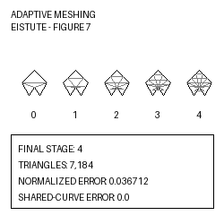

# Adaptive Meshing of Non-Manifold Parametric Patch Complexes

[](http://www.replicabilitystamp.org#https-github-com-tiagosombrra-adaptive-nonmanifold-meshing-grsi)
[](https://doi.org/10.1016/j.cag.2026.104707)
[](LICENSE)

**Graphics Replicability Stamp awarded on 29 July 2026.**

**Final version of record published in *Computers & Graphics*.**

Replication package for the published article:

> Tiago Guimarães Sombra, Joaquim Bento Cavalcante-Neto, and Creto Augusto Vidal.  
> **Adaptive Meshing of Non-Manifold Parametric Patch Complexes with Shared-Curve Compatibility.**  
> *Computers & Graphics*, 2026, Article 104707.  
> DOI: [10.1016/j.cag.2026.104707](https://doi.org/10.1016/j.cag.2026.104707)

The package contains the C++17 implementation, the Book, Eistute and Decor Shelf evaluation models, article and ablation configurations, archived reference data, and scripts for reproducing representative results from the paper.



## Quick reproduction — Figure 7

The primary GRSI reproduction target is **Figure 7**, Section 4.3, “Eistute model”.

### Windows

Open PowerShell in the repository root and run:

```powershell
.\reproduce_eistute_windows.bat
```

From MSYS2 UCRT64 or Git Bash, use:

```bash
cmd.exe //c reproduce_eistute_windows.bat
```

### Linux

Linux execution is provided as an additional convenience but is not the primary GRSI review platform:

```bash
./reproduce_eistute_linux.sh
```

Expected final output:

```text
Eistute final stage verified: 4
Triangles: 7184
Published Eistute target triangle count verified.
Representative Eistute result reproduced successfully.
```

Generated data are written under:

```text
results/eistute/
```

The representative triangular mesh is an OBJ file whose name ends with:

```text
passo_4_malha_4.obj
```

## Representative result and verification scope

Figure 7 presents five saved mesh states numbered 0, 1, 2, 3 and 4. In the configuration files, `ADAPTIVE_MAX_STEPS` denotes the highest saved stage index; therefore, the Eistute value `4` produces states 0–4.

The representative target is the saved **stage-4 candidate mesh** used in Figure 7. The implementation saves rejected candidates for analysis. In the tested workflow, the transition to stage 4 is rejected by the hybrid acceptance criterion, but the stage-4 OBJ is intentionally retained and verified against the archived paper target.

| Metric | Archived value | Automatic reproduction check |
|---|---:|---|
| Highest saved stage | 4 | Yes, exact |
| Triangles | 7,184 | Yes, exact |
| Normalized error | 0.036712 | Archived reference |
| Error reduction | 96.3288% | Archived reference |
| Triangles with quality `q >= 0.60` | 58.6303% | Archived reference |
| Recorded mean shared-curve compatibility error | 0.0 | Archived reference |

The one-command reproduction script compiles the implementation, executes the Eistute article configuration, verifies that stage 4 was generated, and checks the exact triangle-count target. The remaining numerical values are retained in the archived reference files and are not presented as automatically recomputed acceptance checks.

## Reproduction map

| Paper artifact | Command | Generated output | Verification |
|---|---|---|---|
| Figure 7, Eistute stage 4 | `reproduce_eistute_windows.bat` or `reproduce_eistute_linux.sh` | `results/eistute/` | Stage 4 and 7,184 triangles |
| Book experiment | `scripts/run_book_windows.bat` or `scripts/run_book_linux.sh` | `results/book/` | Structural execution check |
| Decor Shelf experiment | `scripts/run_decor_shelf_windows.bat` or `scripts/run_decor_shelf_linux.sh` | `results/decor_shelf/` | Structural execution check |
| Archived Eistute reference | `python scripts/verify_reference.py` | No new mesh is generated | Archived OBJ and CSV checked against the JSON target |

Book and Decor Shelf currently have structural execution checks. The archived exact numerical target used for GRSI validation is the Eistute stage-4 result.

## Supported platform for GRSI review

The primary supported review platform is:

- Windows 10 or Windows 11, 64-bit;
- MSYS2 UCRT64 toolchain;
- CMake;
- GCC/MinGW-w64 with C++17 support;
- Python 3.

Eigen headers required by the implementation are bundled under `libs/Eigen/`. The project does not require a GPU, MPI, OpenMP or proprietary software for the representative execution.

On MinGW, the build links the compiler runtime statically to avoid accidentally loading incompatible `libgcc` or `libstdc++` DLLs from another toolchain in `PATH`.

For a clean Windows installation, follow [`INSTALL_WINDOWS.txt`](INSTALL_WINDOWS.txt). The exact environment recorded for the representative run is available in [`TESTED_ENVIRONMENT.txt`](TESTED_ENVIRONMENT.txt).

## Verify the archived reference

This validation does not execute the meshing algorithm. It verifies the archived OBJ and CSV against the JSON target:

```powershell
python scripts\verify_reference.py
```

## Run all three models

Windows:

```powershell
.\run_grsi.bat
```

Linux:

```bash
./run_grsi.sh
```

Results are written under:

- `results/book/`;
- `results/eistute/`;
- `results/decor_shelf/`.

## Run one model

Windows:

```powershell
.\scripts\run_book_windows.bat
.\scripts\run_eistute_windows.bat
.\scripts\run_decor_shelf_windows.bat
```

Linux:

```bash
./scripts/run_book_linux.sh
./scripts/run_eistute_linux.sh
./scripts/run_decor_shelf_linux.sh
```

## Numerical diagnostics

The run log reports `FindUV` calls that reach the configured iteration limit. This counter is retained as a numerical diagnostic and is not used by the GRSI triangle-count verifier.

The implementation also prints legacy internal timing fields. These fields are not used as reproducibility targets. Use an external wall-clock measurement when execution time must be reported.

## Scope and limitations

This repository is an experimental replication package for adaptive meshing of non-manifold **parametric patch complexes** whose shared curves are explicitly represented in the input topology.

It is not intended to be:

- a general-purpose triangle-mesh remeshing or repair library;
- an automatic CAD or arbitrary polygon-mesh conversion system;
- a guarantee that untested models will satisfy the archived numerical targets.

The GRSI verification covers the documented representative workflow and repository data. Other inputs may require configuration changes and are outside the certified reproduction scope.

## Replicability record

The tested-environment record identifies commit:

```text
a4d943dc64191c419eb6efcb2656e3ee76a8f5f0
```

That commit contains the hardened Windows reproduction workflow used to collect the environment record. The commits between that point and the GRSI award record update submission metadata, provenance documentation, the author preprint, validation metadata and the stamp notice; they do not modify `src/`, `include/`, `configs/`, `input_models/` or `reference/`.

For exact archival work, cite the repository version or commit used in addition to citing the associated article. File-level checksums are recorded in [`MANIFEST.sha256`](MANIFEST.sha256), and the origin of the scientific snapshot is documented in [`SOURCE_SNAPSHOT.txt`](SOURCE_SNAPSHOT.txt).

## Published article

The associated article is published as the final version of record in *Computers & Graphics*:

- DOI and canonical version-of-record link: [10.1016/j.cag.2026.104707](https://doi.org/10.1016/j.cag.2026.104707);
- [ScienceDirect article page](https://www.sciencedirect.com/science/article/pii/S0097849326001780);
- article number: 104707;
- publisher item identifier (PII): S0097849326001780, formatted as S0097-8493(26)00178-0.

The DOI is the persistent link that should be used for citation and access to the published article.

This repository includes the authors' original pre-peer-review manuscript at [`paper/preprint.pdf`](paper/preprint.pdf). It does not redistribute the publisher-formatted version of record.

## Environment report

After installing the dependencies and completing the representative run, generate a local tested-environment record:

```powershell
powershell -ExecutionPolicy Bypass -File .\scripts\collect_environment_windows.ps1
```

This creates `TESTED_ENVIRONMENT.txt`. When preparing a new archival snapshot, confirm that the recorded repository commit matches the version being archived.

## Package validation

Run:

```powershell
python .\scripts\validate_grsi_package.py
```

Before creating a new archival snapshot, regenerate and validate `MANIFEST.sha256` using the scripts under `scripts/`.

<details>
<summary>GRSI submission and review files</summary>

- `GRSI_SUBMISSION.txt`: paper, authors, supported OS and representative result;
- `GRSI_LIABILITY.txt`: authorization for review and public advertisement after approval;
- `INSTALL_WINDOWS.txt`: clean-machine installation and compilation instructions;
- `DATA_PROVENANCE.md`: input-model provenance and redistribution declaration;
- `GRSI_FORM_VALUES.txt`: values prepared for the online submission form;
- `docs/GRSI_REVIEW_GUIDE.md`: reviewer-oriented workflow;
- `assets/grsi_representative.png`: 250 × 250 representative image;
- `paper/preprint.pdf`: direct author-preprint PDF required by the submission form;
- `paper/README.md`: version and publication-status information for the preprint.

</details>

## Repository structure

- `src/`, `include/`: scientific implementation;
- `libs/Eigen/`: bundled Eigen headers retained from the experimental snapshot;
- `input_models/`: article evaluation models;
- `configs/`: article and ablation configurations;
- `reference/`: archived Eistute reference data;
- `scripts/`: build, execution and verification scripts;
- `assets/`: representative submission image;
- `paper/`: author preprint and publication-status information;
- `docs/`: provenance and reproducibility notes.

## Citation

If this replication package or its implementation contributes to your work, please cite the associated article:

```bibtex
@article{sombra2026adaptive,
  title   = {Adaptive Meshing of Non-Manifold Parametric Patch Complexes
             with Shared-Curve Compatibility},
  author  = {Sombra, Tiago Guimar{\~a}es and
             Cavalcante-Neto, Joaquim Bento and
             Vidal, Creto Augusto},
  journal = {Computers \& Graphics},
  year    = {2026},
  pages   = {104707},
  doi     = {10.1016/j.cag.2026.104707},
  url     = {https://doi.org/10.1016/j.cag.2026.104707}
}
```

Machine-readable citation metadata are available in [`CITATION.cff`](CITATION.cff). GitHub users can also select **Cite this repository** to obtain the preferred article citation.

## License

The source code is distributed under the [MIT License](LICENSE). Third-party notices are documented in [`THIRD_PARTY_LICENSES.md`](THIRD_PARTY_LICENSES.md). Input-model provenance and redistribution terms are documented in [`DATA_PROVENANCE.md`](DATA_PROVENANCE.md).

## Provenance

The scientific source code, models and configurations were derived exclusively from the archived experimental snapshot identified in [`SOURCE_SNAPSHOT.txt`](SOURCE_SNAPSHOT.txt). Later development branches were not incorporated.
