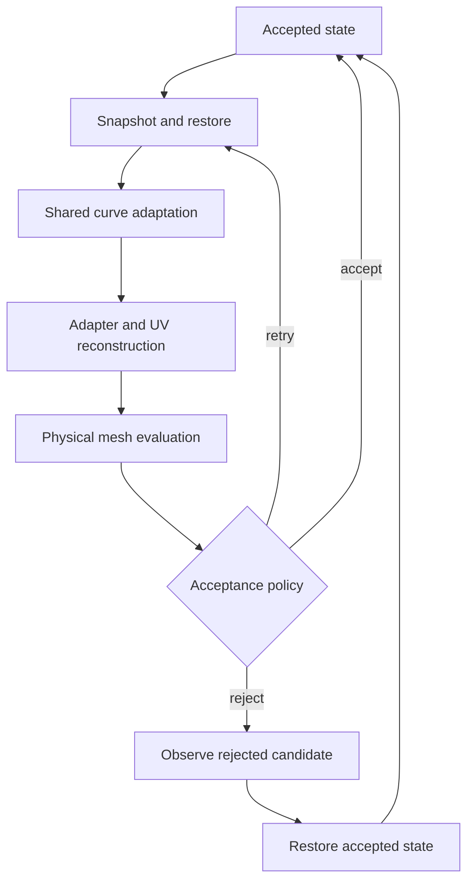

# Mesh architecture and lifecycle inventory

Initial inventory base: `d4561c9421226503cb4a478faad71ed5ad012381` (stage 2, #5).
Current production counts and contracts below follow the deterministic inventory.
Detailed earlier boundary sections are historical; PROJECT_STATE.md records the
current qualified scope and queue. This is engineering/lifecycle documentation,
not a new generator or scientific technique.

The generator retains distinct parametric patches, canonical boundary curves,
physical meshes and CRABMesh UV reconstruction. C01-C22 retain the established
domain, identity, ownership and ordered reconstruction contracts. Bounded stage 3
repairs do not establish whole adaptive rollback or whole-process memory safety.

C23 maps the charge input boundary: input_output/control_patch_reader.cpp returns
unique control-only patch owners; estimate/charge_input_estimate.cpp reconstructs
Geometry-owned patches from automatic coordinate-only controls. Geometry owns
committed curves/patches; returned patch lists and curve incidence entries borrow.
Failed pending construction retires only exclusively appended observer suffixes.
The serial ReaderFilePatches interning/orientation path remains distinct from
this legacy workload-estimation path. Their matching conventions are preserved,
not consolidated. See [the bounded audit](../evidence/STAGE3_CHARGE_INPUT.md).

## Evidence and coverage

The [ordinary Hermite observer audit](../evidence/STAGE3_HERMITE_OBSERVER_AUDIT.md)
retains 25 literal roots and nine original expired-observer ASan failures.
C29/ADR-0037 now qualifies completed Hermite retirement through full exact-head/
main gates (PR #98); see [the bounded repair](../evidence/STAGE3_HERMITE_OBSERVERS.md).
Current curves must remain live through stable, all-match, nonallocating removal.
Constructor publication failure is the next single audit; failed adoption,
foreign/copied/current-curve rebinding and complete-process roots remain open.

C22/ADR-0036 defines qualified initialized detached numeric copies, not complete
geometry clones. The [slice 35 evidence](../evidence/STAGE3_DETACHED_PATCH_COPY.md)
records full exact-head/main qualification of basis/zero metadata/internal flags,
defined numeric reads/order and detached curves/SubMesh. Completed Hermite
retirement is separately qualified by slice 36; foreign/current-patch rebinding
remains open.

C22's [pointer-taking patch-copy audit](../evidence/STAGE3_PATCH_COPY_AUDIT.md)
records historical ID/defined numeric payload transfer with empty curves and
null SubMesh. Its source-only initialization omissions are addressed separately
by bounded slice 35; no original indeterminate fields are evaluated and no
complete geometry clone is qualified.

C02/ADR-0035 defines explicit Model adoption and noncopyable/nonthrowing transfer.
The bounded qualified repair and its exact-head/main gate evidence are recorded in
[the repair evidence](../evidence/STAGE3_MODEL_OWNERSHIP.md);
the original Model audit remains historical evidence.
No alternate caller preparation or patch observer rebinding qualification follows.

C27/ADR-0034 makes serial parsed-control results and pending reconstructed patches
explicit unique owners. The owning-result API is a bounded source migration;
committed Geometry prefixes can remain after later failure. Parser/validation,
interning tolerance, curve sharing/directions and numerical expressions remain
unchanged. Other loaders, Model/copy and MPI/Hermite remain separate obligations.
See STAGE3_SERIAL_READER.md for exact qualification and failure inventory.

Completed Bezier observer retirement and dependent Geometry assignment are
specified separately in C26/ADR-0033. Current borrowed curves must outlive the
patch destructor. Geometry member declaration order already retires patches
first; populated move assignment needs the same dependency order explicitly.
Qualification status remains in PROJECT_STATE.md and STAGE3_BEZIER_OBSERVERS.md.
The finite remaining lifecycle obligations are in STAGE3_CLOSURE_INVENTORY.md.

[source_inventory.json](source_inventory.json) deterministically covers all
151 first-party C++ files: 73 translation units and 78 headers, plus hashes for
the 10 CMake inputs (including isolated memory probes). It records 588 potential literal include directives and
339 distinct directed first-party include edges. Conditional branches are kept;
this is not the active preprocessed graph. The 16 directory groups below are
source organization, not automatically inferred architectural layers.

[contracts.json](contracts.json) contains 27 reviewed contracts with 169 exact
source anchors. The checker rejects stale files, missing anchors and empty
coverage. Matching anchors establishes traceability; it does not prove the
semantic statements or all runtime paths. The statements below come from
focused source review, with uncertainty and deferred qualification stated.

| Directory family | Files | Responsibility and relevant boundary |
| --- | ---: | --- |
| cli | 1 | RuntimeConfig, validation, process globals, thin-entry candidate; currently src/main.cpp also supplies legacy runtime definitions |
| generator | 16 | Initial mesh, adaptive policy/budgets/history, retries, rollback, acceptance, saving and quality/report aggregation |
| adapter | 4 | Curve discretization and physical/UV mesh conversion around each CRABMesh reconstruction attempt |
| data | 18 | Physical point/vector/node/triangle/model/geometry concepts and broad shared definitions |
| data/curve | 9 | Parametric Bezier/Hermite curves, canonical samples and orientation mapping |
| data/patch | 9 | Surface control nets, evaluation, derivatives, inverse mapping and current-submesh observers |
| data/mesh | 4 | Owned physical mesh/submesh/node/element containers |
| data/tree | 2 | One-dimensional curve refinement tree; distinct from the two-dimensional domain quadtree |
| crab_mesh/aft | 18 | UV vertices/edges/faces, boundary, quadtree/templates, front reconstruction and improvement |
| crab_mesh/numerical | 7 | Equation/root functions and bisection variants used by numerical geometry helpers |
| crab_mesh/performer | 5 | ID allocation and ranges; local front IDs remain a separate context |
| curvature | 7 | Analytical surface curvature, discrete physical-mesh curvature and adjacency ordering |
| estimate | 12 | Legacy patch workload estimation and alternative loading path, principally parallel distribution support |
| input_output | 12 | BP/model readers, input validation, independent incidence observation and historical writers |
| parallel | 25 | Communicator/thread abstractions and MPI/OpenMP-specific implementations; effective execution unqualified here |
| timer | 2 | Interval accumulation and reporting; performance qualification deferred |

The fresh compilation database contains all 73 production translation units.
Compilation of a file with inactive branches does not qualify those branches.
Development Python tools/tests, vendored Eigen and publication artifacts have
different roles and are outside the 151-file production count.

## Scientific sequence and actual component boundaries

Contracts C01, C08-C09, C12-C14 and C20 identify the corresponding source symbols.
The serial configuration path constructs Geometry and Model, loads BP patches,
creates the coarse physical mesh and computes the initial curvature/error state.
An adaptive step snapshots the accepted state, restores it for each retry,
adapts shared curves, then adapts patch interiors and evaluates the candidate.
Saving/observing a rejected candidate precedes restoring accepted observers and
curve samples; saving does not change its acceptance classification.



Within `AdvancingFront::execute`, the preserved order is quadtree generation
from the previous UV mesh, neighbor refinement, optional template insertion,
initial-front construction, geometric front generation, conditional topological
fallback, fill and improvement. Curve adaptation, that quadtree, template choice,
front advancement, smoothing and acceptance are scientific preservation points.
The inventory does not replace any of them with another triangulator.

### Geometry and coordinate domains

| Concept | Domain/units | Identity and conversion |
| --- | --- | --- |
| PointAdaptive / NodeAdaptive | Physical XYZ in model units; the input carries no general unit-conversion contract | Physical logical ID; nodes copied into different submeshes can retain the same boundary ID |
| PatchCoons / PatchBezier | Parametric surface over local [0,1] squared, control net in XYZ | Geometry owns the patch; Parameterize maps UV to XYZ and FindUV is an iterative inverse/projection path |
| Canonical CurveAdaptiveParametric | Stored parameter t in [0,1], evaluated point in XYZ | Shared by matching complete control tuples, direct or reversed; it still guides boundary discretization |
| Patch incidence | Local increasing side parameter | Orientation maps t or 1-t; reversal is distinct from the clockwise traversal of sides 2/3 |
| Par2DJMesh::Vertex | Local UV despite x/y accessor names | Temporary per-patch front identity; Adapter maps Vertex pointers to owned physical nodes during one attempt |
| Par2DJMesh::Face | UV triangle, h derived using physical old-triangle area fractions and scaling | Previous TriangleAdaptive UV corners seed old faces; generated faces become physical triangles |
| TriangleAdaptive | Physical triangle with three local UV tuples | Borrowed physical nodes, cached area/normal/angles, per-corner patch parameters |
| Edge::length / Edge::getLen | Euclidean UV length / boundary physical arc normalized by whole curve length | Distinct metrics; physical midpoint integration consumes increasing canonical limits |
| Quality and curvature | Quality is dimensionless; analytical/discrete curvature refer to the surface/physical mesh respectively | UV quality and XYZ quality can differ under surface mapping; analytical and discrete curvature are not duplicate formulas |

There is no new welding operation in canonical curve storage. The input reader
still uses its legacy control interning/matching policies; independent incidence
validation binds the exact source net and detects alterations. Serial OBJ export
deduplicates physical node incidences by logical ID, not by XYZ proximity. One ID
with conflicting coordinates is invalid. Pointer identity, UV-local identity,
physical ID and source-curve identity cannot be interchanged (C07-C09, C21).

### Conversion ledger

| Boundary | Actual source operation | Preservation obligation |
| --- | --- | --- |
| Serial BP to geometry | ReaderFilePatches interns controls, reuses complete curves and passes incidence direction to PatchBezier | Input control net, complete curve identity and all incident sheets |
| Estimator BP input | LoaderBPFile returns unique control-only patches; ChargeEstimate retains them through automatic control construction and consuming Geometry adoption | Historical control IDs/order and curve matching; this path does not adopt the serial interning policy (C23) |
| Canonical samples to local boundary | Adapter traverses ordered curve points and maps local side UV; reverse incidences complement parameters | Same partition and XYZ for every sheet, independent of patch traversal |
| Old physical triangles to old UV faces | Adapter reads GetParametersN1/N2/N3 and allocates temporary Vertex/Face objects | UV belongs to the same patch; h normalization still uses physical area fractions |
| CRABMesh UV result to physical mesh | Parameterize for interior nodes; boundary node copies preserve IDs; map<Vertex*,NodeAdaptive*> resolves generated triangle corners | New owners, coherent adjacency, UV tuples and global IDs survive temporary-front destruction |
| Candidate to saved/accepted state | SaveMesh moves ownership to save_mesh_; policy/logs classify the saved attempt separately | No rejected candidate substituted for an accepted result |
| Rollback to accepted curves | Capture id/XYZ, delete unique current sample pointers, reconstruct by ID and reset curve lists | Observer invalidation is explicit; samples are not stable pointers across retries |

## Ownership, observers and lifetime hazards

| Object/container | Owner/adoption evidenced by source | Observers, copy behavior and teardown |
| --- | --- | --- |
| Geometry | unique_ptr points/vectors/curves/patches; raw Insert APIs adopt | PatchCoons curve lists and CurveAdaptive incident patch lists borrow |
| Model | Exclusive mesh owners retire in reverse insertion order; copy is prohibited and move transfers ownership | geometry_ is borrowed; source becomes empty/null after move; no foreign patch rebinding |
| GeneratorAdaptive | mesh_ and save_mesh_ own physical meshes; Adapter is a member | Current accepted mesh may come from mesh_ or the last saved state; the broader legacy Model collection is a different ownership route |
| MeshAdaptive | unique_ptr submeshes; positional reset deletes replaced owner | A Patch current-submesh observer must be rebound after replacement/rollback |
| SubMesh | unique_ptr nodes/elements; AddNoh moves, SetElement adopts; destruction clears elements before nodes | SetNoh copies scalar state and clears foreign adjacency; caller retains the source. The header now distinguishes copy from adoption |
| TriangleAdaptive | SubMesh owns the element | Node pointers borrow and must outlive the element; construction registers and destruction unregisters current incidences. Replacement transfers the matched observer; geometry-cache refresh remains separate |
| NodeAdaptive | SubMesh owns physical node copies | Adjacent elements are borrowed; general implicit copies retain adjacency. SetNoh clears it at the new mesh boundary. GetNoh on TriangleAdaptive still returns a value copy |
| Curve sample lists | CurveAdaptive explicitly does not own them | Qualified serial graph/sample scopes own reachable fresh samples and release shared aliases under fixed publication rules (C07). Arbitrary foreign publications and full orchestration rollback remain unqualified |
| Default AdvancingFront | Allocates boundary/quadtree; deletes its owned faces, inner edges/vertices, then quadtree | Front receives template owner lists only after allocating observer preparation; setters/external constructors remain unqualified |
| Boundary | Detaches endpoints without allocation, deletes edges, then vertices | Completed-edge curve belongs to the previous outgoing side; borrowed source curve outlives the attempt |
| Edge / Face | Legacy destructors retain endpoint ownership outside shared containers; own distinct midpoint/vector caches | Containers call DetachVertices without allocating; Face releases a midpoint alias to an endpoint. Generic raw adoption still requires unique ownership |
| Quadtree / QuadtreeCell | Quadtree owns its root/bounds when Boundary is attached and registered templates until ordered transfer; cells own children/midpoints. Local guards protect root bounds and incomplete midpoint sets | Leaves/neighbors/front lists observe objects. Failed-tree destruction is qualified; mate/root sharing, other creation/setter paths and retry remain unqualified |
| Adapter attempt | unique_ptr SubMesh until selected result.release() | Temporary old UV faces are deleted on explicit success/failure paths; exceptions before those loops remain unqualified |

C02-C07 and C10-C13 support these observations. This is not a sanitizer report.
RAII containers in one layer do not establish whole-application memory safety.
The detach-before-delete protocol is a proved source design fact; an actual
crash or leak on every such path is not asserted. Stage 3 must challenge partial
construction, replacement, failure, retries and teardown with qualified tools.

The pointer-taking PatchCoons copy constructor calls only the Patch base and
leaves its curve vector empty, while the Bezier pointer-copy path copies other
fields separately (C22). This is not a complete qualified clone contract. The
existing orientation probe checks copied direction flags; it does not qualify
copying every observer or all geometry mutation APIs.

## Dependency and computation ledger

The potential header graph has one strongly connected set of six headers:
boundary, edge, face, quadtree, quadtree_cell and vertex under crab_mesh/aft.
It is a lexical include cycle, not proof of a runtime object cycle. Forward
declarations and a narrow domain boundary can be considered in stage 6 after
lifetime contracts; breaking it mechanically now would not resolve ownership.

Central data/definitions.h exposes broad namespace aliases, Eigen types and
platform/compiler conditionals to many unrelated consumers. Direct vendored
Eigen includes resolve there. The inventory also reports an Eigen/Eigen spelling
from a conditional system-search branch; system include resolution is not
performed. Optional GL, MPI/OpenMP, Linux and Windows headers are potential
dependencies across all branches, not mandatory serial runtime dependencies.

| Similar computation/concept | Source locations/contracts | Consolidation disposition |
| --- | --- | --- |
| Curve length, midpoint and numerical roots | CurveAdaptiveParametric, Edge::makeParamMid, numerical bisection helpers; C08/C16 | Geometry integration primitive may be shared later; canonical/local intervals and existing solver/roundoff behavior must remain explicit |
| Analytical vs discrete curvature | CurvatureAnalytical and CurvatureDiscrete; C14 | Keep distinct quantities and their adjacency/derivative dependencies |
| UV vs physical quality aggregates | Adapter, AdvancingFront, GeneratorAdaptive; C15 | Candidate shared aggregation only after units, stages, thresholds and summation order are compared |
| Physical Point/Vector vs UV Vertex | data vs crab_mesh/aft; C09/C21 | Keep domain types distinct; share only proven mathematical primitives |
| Bezier/Hermite matrices and small inverse systems | Patch/Curve implementations and Eigen aliases; C16/C17 | Inventory actual operations first; stage 5 requires analytic, aliasing and differential controls |
| Serial/OpenMP adaptation implementations | AdaptDomain/AdaptDomainOmp and Generator variants | Similar control flow is not proof of equivalence; effective build routing and thread/lifetime contracts precede consolidation |
| Repeated data copies and saved candidates | Node value access, SubMesh::SetNoh, save_mesh_; C04/C05/C13 | Measure ownership and retention needs; removing copies may invalidate independent submesh observers or the regression trace |
| Output/report writers | Generator WriteMesh/WriteQualityMesh, WriteOBJFile and independent observer | Unify only after identity, ordering, field meaning, precision and historical compatibility are specified |
| Timer vs Data::time | timer/timer.cpp and data/definitions.cpp; C19 | Qualify clock behavior before benchmarks or claims about optimization |

### Configuration gap requiring later qualification

CMake sets AP_MESH_HAS_OPENMP/AP_MESH_HAS_MPI; production branches primarily
test USE_OPENMP/USE_MPI, defaulted false in data/definitions.h. No bridge for the
AP_MESH_HAS names appears in the indexed production files (C18). External
defines can change that result. Stage 4 must prove effective preprocessor values
and selected execution path when toggles are enabled. Linking OpenMP or passing
two threads alone does not qualify parallel execution. Historical process runs
remain historical observations; this stage makes no new parallel claim.

## Invalidation contracts and next step

Changing coordinates requires considering triangle normal/area/angle caches,
node curvature/adjacency, front edge midpoint/vector/box caches and quality
summaries. Changing a control requires Bezier coefficient and length/derivative
state coherence. Several public control setters assign a point without rebuilding
coefficient matrices; the curve setters differ in recomputing length (C17).
These mutation APIs are not qualified merely by immutable-input CLI regression.

Replacing a candidate invalidates old SubMesh/Node/Element observers; restoring
curve samples invalidates their old addresses even when IDs and XYZ are equal.
No coordinate-proximity test may stand in for that lifecycle transition.
The next implementation work is staged in
[REFACTOR_SEQUENCE.md](REFACTOR_SEQUENCE.md), with the domain/lifetime decision
record in [ADR-0001](../decisions/ADR-0001-mesh-domains-and-lifetimes.md).

Reproduce the retained evidence with:

```sh
python tools/inventory_architecture.py --output docs/architecture/source_inventory.json --contracts docs/architecture/contracts.json --check
python -m unittest discover -s tests/tooling -p test_architecture_inventory.py -v
```

All source anchors and retained inventory are checked in the normal tooling
CTest through the new test module. Eight new positive/negative controls cover
missing/added source coverage, comment handling and exact directive lines,
potential cycles, missing/outside anchors, duplicate/empty contract IDs and the
actual retained inventory. Whole-stage qualification is recorded separately in
the stage 2 evidence report; lexical coverage does not replace scientific or
dynamic memory regression.

## Quadtree construction boundary (#20)

Root extents and midpoint construction use local ownership until adoption.
Five calibrated scopes cover generation, uniform subdivision, old-face and
actual neighbor refinement; failed trees permit destruction only. Successful
allocation, cell/neighbor/leaf order and scientific expressions are preserved.
Mate/root sharing, retry and full-process/parallel qualification remain open.
See ADR-0006 and `../evidence/STAGE3_UV_TREE.md`.

## Angle-query temporary boundary (#23)

The angle-query temporary borrows endpoints and must detach them on every exit
before the legacy Edge destructor runs. C11 records this narrow exception
guarantee. Ten calibrated sweeps cover four matches and nonadjacency with empty/
populated observers, including successful helper reuse after failure. Original
and candidate successful geometry/allocation counts match. General copied
observers, other mutation/helpers and curve operations remain separate scopes.
See ADR-0007 and `../evidence/STAGE3_ANGLE_HELPER.md`.

## Parametric midpoint cache boundary (#26)

Prepare the replacement midpoint/normalized length before changing live Edge
state, then destroy the old owned cache and commit. Old-cache observer lifetime
ends on successful commit; allocation failure preserves its identity/geometry.
Curve evaluation scratch remains mutable. C11 and ADR-0008 record the measured
four-side/two-direction, fallback and null-curve boundary. Zero allocations in
the direct polynomial examples do not qualify failures inside all curve APIs.
Continue other curve mutation/constructor/setter paths before sample ownership,
initialization and rollback; full-process and parallel qualification stay open.
