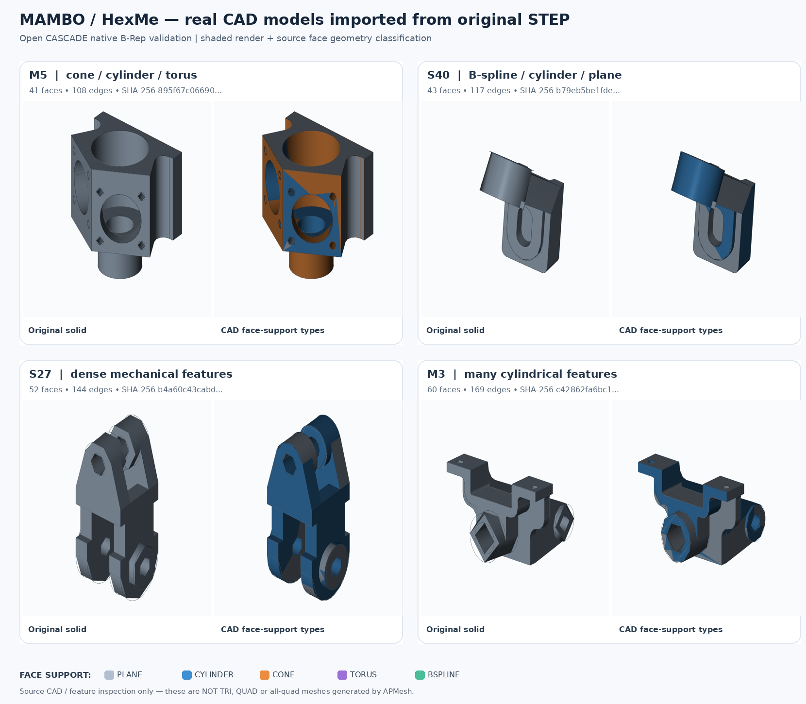

# Non-manifold benchmark corpus and reverse-patch feasibility

**Status:** scientific priority is ORIGINAL complex CAD. **Four byte-verified MAMBO STEP originals (M5/S40/S27/M3) have now PASSED native Open CASCADE import, topology profiling and source-rendered visual evidence**; no original multi-sheet positive or APMesh accepted meshing demonstrated. R2/R3 synthetic fixtures remain tests only. Updated 2026-11-15.
**Frozen planning base:** main `f6050ec1b12b508b9d8d761db1fa9a95ab1e3d94`.
**Research branch:** `research/benchmark-corpus-reverse-patches`, draft PR #225.

## S1 native original CAD evidence (2026-11-15)

**First actual complex-source gallery:**



- [Full S1 native CAD audit](S1_NATIVE_ORIGINAL_CAD_AUDIT.md) — original file raw SHA-256, original Git blob SHAs, Open CASCADE solid validity, full face-edge-use histogram, edge degeneracy, support-surface types and per-face complexity.
- [Four native source-specific image pairs and combined gallery](gallery/source_cad/mambo_originals_native_gallery.png) — real CAD import, **not APMesh surface TRI/QUAD meshes**.
- [Native importer/render + feature-incidence source](probes/native_source_audit.py), [7 scoped local regression controls](probes/test_native_source_audit.py), [machine-readable receipts](evidence/s1/native_source_summary.json).
- Per-file rights are still not reviewed for redistribution; **raw CAD source STEP files are NOT in this repository**. Import, native B-Rep validation and rendered provenance pass only for these four; independent external non-manifold G2, general bicubic conversion and TRI R5 remain OPEN.

## Scientific priority correction — 2026-11-15

**The primary scientific candidates are complex ORIGINAL CAD assets, not three-box, T-Junction or Cross-Junction synthetic controls.** The latter remain conversion/regression fixtures only. Do not use their success counts as external topological generalization. The scientific benchmark needs two separately labeled external populations: geometric-complexity CAD controls versus genuinely original multi-sheet non-manifold sources; currently zero externally validated multi-sheet positives.

- [Reprioritized scientific plan](SCIENTIFIC_MODEL_SELECTION_V2.md): source-real geometry before new synthetic models, per-asset rights, graphical source provenance, native CAD and independent non-manifold gates.
- [Direct seven-asset original STEP screening](R2_COMPLEX_CAD_STEP_SCREEN.md): seven exact pinned STEP entity graphs inspected; no explicitly 3+-face shared EDGE_CURVE identified, but geometric coincidences and native topology still not checked.
- [First complex-source cohort](COMPLEX_CAD_SOURCE_SHORTLIST.csv): MAMBO M5, S40, S27, M3 PRIMARY; M1/S8 SECONDARY; Quarter Torus ADVERSARIAL. Original CAD image slots remain **PENDING** until real models can be imported and rendered.
- [Source STEP reference graph analyzer](probes/step_graph_screen.py), [six local controls](probes/test_step_graph_screen.py): standard-library-only independent reproduction tool. Raw SHA-256 is computed only when actual local original bytes are acquired; it is NOT inferred from upstream Git blob SHA.
- **No new APMesh TRI/QUAD output or external model admission** is claimed from this screening.

## Evidence and review sequence

1. [R0 baseline audit](R0_BASELINE_AUDIT.md): historical Book/Eistute/Decor model identity, frozen main and concurrency; **no fresh production regression**.
2. [R1 source discovery](R1_DISCOVERY_REPORT.md): 40 individually traceable candidates (29 HexMe original CAD files, six Fusion Energy procedural scripts, five upstream Thingi10K invalid-input leads).
3. [R2 topological screening](R2_TOPOLOGY_SCREEN.md): eight structurally traversable original STEP edge-use graphs; one torus/vertex-loop limitation; five local CadQuery pinned-source mirrors. Explicit STEP edge identity is **not** the same as geometrically coincident edges from separate solids.
4. [R2 native-kernel interface proof](R2_NATIVE_INTERFACE_PROOF.md): three-cuboid STEP export/import and 4 reconstructed spatial-interface sheets; 15 native/JSON controls passed; G2 remains blocked.
5. [R2 kernel-valid non-manifold BREP control](R2_VALID_NONMANIFOLD_BREP.md): one constructed four-face shared topological edge; 19 local controls including native BREP export/import; external G2 still blocked.
6. [R3 analytic bicubic pilot](R3_ANALYTIC_BICUBIC_PILOT.md): 4 indexed BP patches, 52 unique control vertices, one canonical 4-incident C0 boundary; 13 new controls and 32 total R2+R3 local tests passed. Not an external admitted model or APMesh mesh generation.
7. [R3 curved bicubic pilot](R3_CURVED_BICUBIC_PILOT.md): curved spatial cubic C0 with four true kernel face incidences and one reversed local orientation; 12 new tests and 44 local R2/R3 tests; no external CAD conversion.
8. [R3 representability matrix](R3_REPRESENTABILITY_MATRIX.md): explicit supported, negative, blocked and untested cases.
9. [R3.C2 T/Cross partial contacts](R3_PARTIAL_CONTACT_PILOT.md): native face Common/Cut, source-to-subface provenance, 5/10 exact rectangular BP patches, 2/4 triple-incidence curves; 19 new local controls.
10. [R3.C2 case matrix](R3C2_CASE_MATRIX.md): accepted, explicitly rejected and not-yet-supported trims and near-contact controls.
11. [Scientific visual gallery](gallery/README.md): attributed source imagery and author-authored schematic with available/unsupported representation stages.
12. [Candidate register](candidate_register.csv): all 40 are still DISCOVERED; 13 are annotated with screening observations and one extra torus limitation, but no G2 or complete G1-G7 admission.
13. [Execution plan](PLAN.md), [model admission protocol](MODEL_ADMISSION_PROTOCOL.md), [candidate source inventory](CANDIDATE_SOURCES.md) and [risk/decision register](RISK_AND_DECISION_REGISTER.md).

## Limited research probes

Located under `probes/`; not part of the production CMake build:

```sh
python -m unittest discover -s docs/research/nonmanifold-benchmark/probes -p "test_*.py" -v
python docs/research/nonmanifold-benchmark/probes/export_source_mirror.py --output-dir build/research-r2
python docs/research/nonmanifold-benchmark/probes/cadquery_contact_probe.py
python docs/research/nonmanifold-benchmark/probes/step_structural_screen.py path/to/permitted/original.step
python docs/research/nonmanifold-benchmark/probes/interface_graph_probe.py --output build/research-r2/three_cuboids_interface_graph.json
python docs/research/nonmanifold-benchmark/probes/validate_interface_graph.py build/research-r2/three_cuboids_interface_graph.json
python docs/research/nonmanifold-benchmark/probes/nonmanifold_sewing_probe.py --interface-graph build/research-r2/three_cuboids_interface_graph.json --output-json build/research-r2/sewn_complex_report.json --output-brep build/research-r2/four_sheet_nonmanifold.brep
python docs/research/nonmanifold-benchmark/probes/build_analytic_bp.py --graph build/research-r2/three_cuboids_interface_graph.json --out-bp build/research-r2/four_sheet_planar.bp --out-sidecar build/research-r2/four_sheet_planar.sidecar.json
python docs/research/nonmanifold-benchmark/probes/audit_analytic_bp.py --bp build/research-r2/four_sheet_planar.bp --sidecar build/research-r2/four_sheet_planar.sidecar.json --native-brep build/research-r2/four_sheet_nonmanifold.brep
python docs/research/nonmanifold-benchmark/probes/curved_bicubic_pilot.py --out-dir build/research-r3-curved
python docs/research/nonmanifold-benchmark/probes/audit_curved_bicubic.py --bp build/research-r3-curved/four_sheet_curved.bp --sidecar build/research-r3-curved/four_sheet_curved.sidecar.json --brep build/research-r3-curved/four_sheet_curved.brep
python docs/research/nonmanifold-benchmark/probes/r3c2_native.py --case t_junction --output-dir build/research-r3c2
python docs/research/nonmanifold-benchmark/probes/r3c2_native.py --case cross_junction --output-dir build/research-r3c2
python docs/research/nonmanifold-benchmark/probes/r3c2_bp.py --case t_junction --output-dir build/research-r3c2
python docs/research/nonmanifold-benchmark/probes/r3c2_bp.py --case cross_junction --output-dir build/research-r3c2
python docs/research/nonmanifold-benchmark/probes/r3c2_audit.py --bp build/research-r3c2/t_junction.bp --sidecar build/research-r3c2/t_junction.sidecar.json --brep build/research-r3c2/t_junction_interface.brep
python docs/research/nonmanifold-benchmark/probes/r3c2_audit.py --bp build/research-r3c2/cross_junction.bp --sidecar build/research-r3c2/cross_junction.sidecar.json --brep build/research-r3c2/cross_junction_interface.brep
```

The STEP scanner requires Python; the CadQuery probes additionally require CadQuery/OCP. The bounded local R2/R3 suite has **44 passing controls** and R3.C2 adds **19 passing T/Cross source-mirror controls** (**63 total research controls**), including near-contact false-welding rejection. Exact source Git blobs and file hashes are recorded in the R3 curved report. This does not certify the original upstream package or the production APMesh build. See R2 report for command scope, results and missing gates.

## Corpus partitions

HISTORICAL (three original author-created article baselines), SYNTHETIC_POSITIVE (analytic engineering controls), EXTERNAL_POSITIVE (**none admitted**), MANIFOLD_CONTROL (independently classified CAD quality/fitting controls), NEGATIVE_UNSUPPORTED (invalid/ambiguous/vertex-contact cases).

## Scientific boundaries

No production C++, published `.bp`, scientific acceptance policy or numerical oracle has been changed. No third-party raw asset is committed. No external 3+-sheet patch-edge source has been verified. Future reconstruction, conversion, TRI qualification and QUAD/TRI/all-quad/anisotropy work require independent gates and advisor decisions before scientific claims.
