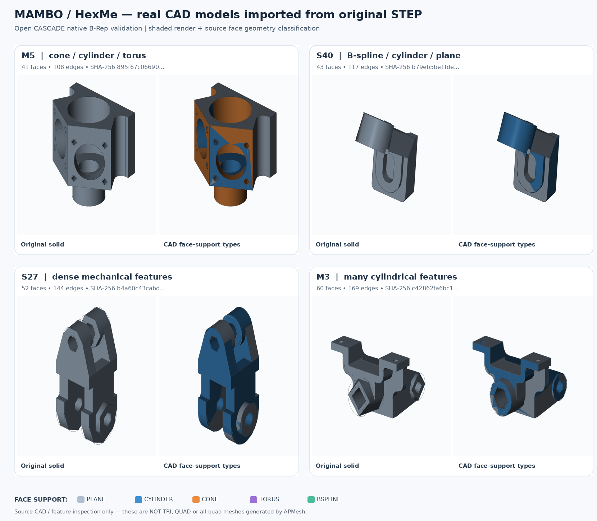

# S1 — Native Open CASCADE audit of four original MAMBO CAD models

**Date:** 2026-11-15. **Research track:** original complex CAD geometry, NOT synthetic R2/R3 controls.
**Upstream dataset:** `cgg-bern/hex-me-if-you-can`, pinned revision `8f00f02579037cc893042f2ee2c910b20e3fb1b0`.
**Source-specific metadata:** each of the four files declares Apache-2.0 in its individual `meta/*.yaml`; legal redistribution review is still OPEN. Raw CAD files were used locally and are NOT committed.
**Importer/renderer:** CadQuery 2.8.0 + OCP / OCCT 7.9.3.1 + VTK 9.6.2 offscreen. Native import was performed on byte-exact source STEP files. All four B-Reps passed `isValid()` and were single solids with a single shell.

## Actual source CAD images



These figures were generated from **the original pinned CAD geometry**, not manually modeled approximations or an external dataset figure. Every tile has a source SHA-256 prefix. Left = imported shaded solid; right = imported CAD face-support types. The gallery does **NOT** show meshes produced by APMesh.

Individual, source-specific native CAD image receipts:
 - [M5 native source and face type](gallery/source_cad/m5_source_cad.png) — cones, cylinders and toroidal support.
 - [S40 native source and face type](gallery/source_cad/s40_source_cad.png) — imported B-spline faces.
 - [S27 native source and face type](gallery/source_cad/s27_source_cad.png) — dense mechanical feature boundaries.
 - [M3 native source and face type](gallery/source_cad/m3_source_cad.png) — many cylindrical features.

## Measured source geometry and topology

| Original | Valid CAD | Faces | Nondegenerate edges | Degenerate OCCT edges | Native edge-face incidence (1 / 2 / >=3) | Distinct face support | Planar straight four-side candidates | Faces with >1 trimming wire |
|---|---|---:|---:|---:|---|---|---:|---:|
| **M5** | True | 41 | 102 | 6 | 29 / 79 / 0 | CONE: 10, CYLINDER: 17, PLANE: 13, TORUS: 1 | 6 | 8 |
| **S40** | True | 43 | 117 | 0 | 0 / 117 / 0 | BSPLINE: 3, CYLINDER: 14, PLANE: 26 | 9 | 3 |
| **S27** | True | 52 | 144 | 0 | 0 / 144 / 0 | CYLINDER: 18, PLANE: 34 | 20 | 10 |
| **M3** | True | 60 | 169 | 0 | 10 / 159 / 0 | CYLINDER: 26, PLANE: 34 | 10 | 10 |

**All original STEP files specify millimetres** via their `LENGTH_UNIT` STEP entries. All four source files match the pinned upstream Git blob SHA-1 exactly, in addition to independently computed SHA-256. The original Git blob hash must not be confused with the raw SHA-256.

**Important M5 normalization finding.** Its STEP reference graph contains 102 `EDGE_CURVE` definitions; the native BRep contains 108 distinct `TopoDS_Edge` identities, **six of them degenerate**. The 102 nondegenerate native edges agree with the source-level count. Native face usage is `29` one-face edges (including degenerate) plus `79` two-face edges. These degenerate edges are not evidence of a 3+-sheet junction; their geometric role must be handled explicitly before converting its seams/periodic faces.

**Important S40 surface finding.** The raw STEP graph counted two explicit B-spline surface entities; native imported face categorization exposes **three** `BSPLINE` faces. Source entity counts and imported face category counts are not interchangeable: one support surface can be used by more than one topological face or the importer may reconstruct face representations. No fitting claim follows from the raw count.

**No external non-manifold positive.** Exact Open CASCADE edge identity (`IsSame`) was used to count **distinct face owners**, not repeated oriented uses of a seam edge. The maximum observed incidence across all four originals was 2. An imported valid single solid with seam/degenerate edges does NOT pass the research gate for original intended 3+-sheet shared-curve geometry.

## Per-source binary provenance

| Original CAD source (pinned) | Bytes | Git blob SHA-1 | Raw SHA-256 |
|---|---:|---|---|
| [`i05o_m5.step`](https://github.com/cgg-bern/hex-me-if-you-can/blob/8f00f02579037cc893042f2ee2c910b20e3fb1b0/original/i05o_m5.step) | 276412 | `d72e5e3cb3de9ebdec80253cfa9b57fa1b7132f7` | `895f67c0669096b287077ac1bb56dad0e117cd96f78334d3129d783fd78b96cb` |
| [`i25o_s40.step`](https://github.com/cgg-bern/hex-me-if-you-can/blob/8f00f02579037cc893042f2ee2c910b20e3fb1b0/original/i25o_s40.step) | 216438 | `917ef72a0a91b8b3e7d16e8009a1b1655154174a` | `b79eb5be1fde71b6a8d086fe14800a1ec62e3a3c4618910c81c64d23718abf3b` |
| [`i22o_s27.step`](https://github.com/cgg-bern/hex-me-if-you-can/blob/8f00f02579037cc893042f2ee2c910b20e3fb1b0/original/i22o_s27.step) | 177702 | `48ada34a4d2fb038ff91131300c6262a9faec217` | `b4a60c43cabd3c72bf61d54a23f36e6e539ad985015d2a7c377885b5d170f8c5` |
| [`i03o_m3.step`](https://github.com/cgg-bern/hex-me-if-you-can/blob/8f00f02579037cc893042f2ee2c910b20e3fb1b0/original/i03o_m3.step) | 245700 | `e472dd5b717b2fdbc7d2bd3e030a856a257d0cb3` | `c42862fa6bc1e94a9bb70e43a7dc9901aa5281d7b58de6ee4699494088286008` |

## R3 representability constraints discovered on the **real** sources

1. The `planar_four_straight_edge_candidate_face_count` column counts only planar faces with exactly one four-edge wire and four unique vertices. These are **potential exact polynomial bilinear-to-bicubic patches**, NOT a completed B-spline/Bezier representation or preserved source feature graph.
2. Other planar faces, multiwire faces, annular regions and faces with holes need an explicit subdivision that preserves source face and edge identities.
3. Native `CYLINDER`, `CONE` and `TORUS` support surfaces are typically rational analytic patches. The current polynomial bicubic `.bp` grammar cannot be assumed to represent them exactly; choose documented segmentation and approximation/error budgets before fitting.
4. `BSPLINE` source faces (S40) may be higher degree, rational or trimmed, even if the name alone is insufficient to classify their exact polynomial degree. Inspect poles/knots/weights and trimming boundaries prior to a bicubic exactness/approximation decision.
5. Candidate success or failure is recorded **per source face and curve**, and must include trimmed-loop combinatorics and source unit scale (mm). No silently welded topology is permitted.

## Reproduction without copying third-party STEP bytes into the repository

Acquire the four pinned originals from their source links above into a local `sources/` directory (external to the repo, respecting per-file rights), then run:

```sh
export APMESH_REAL_CAD_WORKSPACE=/path/to/external/mambo-originals
python docs/research/nonmanifold-benchmark/probes/native_source_audit.py
python -m unittest discover -s docs/research/nonmanifold-benchmark/probes -p "test_native_source_audit.py" -v
```

When source data is intentionally absent, this optional test suite **SKIPs**, and that is not a pass. If the environment variable is set and any source is missing, the test fails. Local development runs with exact originals passed 7/7 tests. The audit script writes SHA-256-locked JSON receipts, original rendered PNGs and a gallery using the same source B-Rep.

Two independent local script executions regenerated all **13 PNG outputs byte-identically** in the current rendering environment, with SHA-256 recorded separately in the local delivery package. Image reproducibility is environment-dependent; only the pinned source, importer and render parameters define the experiment across machines.

## Explicit scientific status

| Gate | Status |
|---|---|
| Pinned original bytes + Git identity + raw SHA-256 | **PASS for four models** |
| Native STEP import, validity and shape/edge incidence | **PASS for measured native source context** |
| Native source-specific geometry gallery | **PASS (shaded + face-type)** |
| Per-file rights/redistribution approval | **OPEN**; upstream metadata says Apache-2.0 |
| Independent verification of original external 3+-sheet non-manifold geometry | **NOT PASS**; 0 demonstrated |
| Exact or bounded bicubic conversion for these original models | **NOT RUN** |
| Accepted TRI runtime APMesh, QUAD/TRI or anisotropic mesh | **NOT RUN** |
| Historical exact-head CMake/CTest and method comparison | **NOT RUN** |

**Next scientific gate S3:** identify model-specific B-Rep trim/feature curves and construct defensible four-sided patch atlases, starting with a bounded M5/S40 case and recording explicit approximation errors. In parallel, S4 must still locate and independently verify a genuinely non-manifold original external source. M5/S40/S27/M3 cannot support that distinct claim by themselves.
