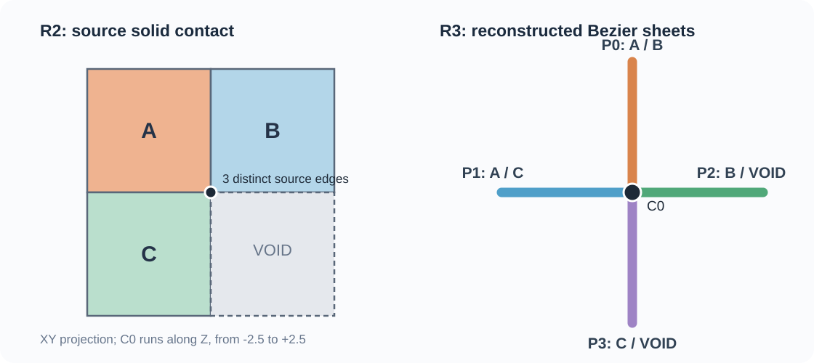

# Scientific model gallery — evidence-indexed, not a claim of meshing success

**Status updated 2026-11-15:** R0-R1 sources cataloged, R2 constructed non-manifold BRep control, R3 exact **planar and nonplanar curved analytic** bicubic BP pilots; no APMesh TRI/QUAD/all-quad/anisotropic meshes generated on the new pilot. No historical input changed.

## 1. Source → reconstructed geometry → Bezier representation

This diagram is an analytical XY cross-section, **not** a photograph or a generated mesh. A, B and C occupy three quadrants; the fourth region is VOID. C0 runs in the Z direction; the four surface sheets are A/B, A/C, B/VOID and C/VOID. R3 retains one canonical shared cubic boundary represented by control vertex IDs 0-3 in all four bicubic patches.

- [Source image: Three Touching Cuboids (Fusion Energy)](https://raw.githubusercontent.com/fusion-energy/model_benchmark_zoo/main/images/three_touching_cuboids.png)
- [Source implementation (pinned)](https://github.com/fusion-energy/model_benchmark_zoo/blob/3a2e69fe62209e33a1e176d816609d69a2aebadc/src/model_benchmark_zoo/three_touching_cuboids.py)
- [R2 native BRep proof](../R2_VALID_NONMANIFOLD_BREP.md)
- [R3 exact 4-patch BP fixture](../fixtures/four_sheet_planar.bp)
- [R3 measured representation proof](../R3_ANALYTIC_BICUBIC_PILOT.md)

## 2. Historical and candidate image references

| Model | Official image/reference | Experimental role | Claimed status |
|---|---|---|---|
| Eistute | [APMesh original representative image](https://github.com/tiagosombrra/apmesh-modernization/blob/main/assets/grsi_representative.png) | Historical article TRI reference | Historical; Stage 4 OBJ is retained **rejected candidate**, not accepted |
| Book | [Historical input](https://github.com/tiagosombrra/apmesh-modernization/blob/main/input_models/book_v7a.bp) | Historical article reference | Image not newly validated; no fabricated render |
| Decor Shelf | [Historical input](https://github.com/tiagosombrra/apmesh-modernization/blob/main/input_models/ribbed_bracket_nm_decor.bp) | Historical article reference | Image not newly validated; no fabricated render |
| Three Touching Cuboids | [Source image](https://raw.githubusercontent.com/fusion-energy/model_benchmark_zoo/main/images/three_touching_cuboids.png) | Geometry contact, four-sheet controlled R2/R3 reconstruction | Local analytic control; external G1/G2 **blocked** |
| T Junction | [Source image](https://raw.githubusercontent.com/fusion-energy/model_benchmark_zoo/main/images/t_junction.png) | Partial overlap and feature splitting | Discovered; not converted |
| Cross Junction | [Source image](https://raw.githubusercontent.com/fusion-energy/model_benchmark_zoo/main/images/cross_junction.png) | Multi-body partial interface contact | Discovered; not converted |
| Two Touching Cuboids | [Source image](https://raw.githubusercontent.com/fusion-energy/model_benchmark_zoo/main/images/two_touching_cuboids.png) | Contact control | Discovered; not converted |
| Tangent Spheres | [Source image](https://raw.githubusercontent.com/fusion-energy/model_benchmark_zoo/main/images/tangent_spheres.png) | Point-contact negative control | Discovered; not converted |
| HexMe/MAMBO | [HexMe official catalog](https://hexme.algohex.eu/catalog/) | CAD shape, curvature and QUAD controls | Individual image/model approval pending |

## 3. Required image sequence per final accepted model

Keep the following scientific states separate, with evidence-verified labels and hashes: source CAD/BRep; edge/sheet graph (source vs reconstructed topology); exact or bounded bicubic BP control net; TRI mesh and accepted/rejected stages; mixed QUAD/TRI; all-quad; anisotropic metric and resulting mesh. At present only the initial source/control/Bezier stages have evidence for the three-cuboid pilot. **Do not draw future mesh results as if they have been computed.**

Image and raw model licensing follow source-file rights review; linked upstream images are not copied or redistributed in this Git repository. MATLAB/Matplotlib renderings in downloadable local research packages are author-generated geometry illustrations, not additional independent dataset assets.

## 4. Curved synthetic control (2026-11-15)

The source-built curved pilot preserves the four-sheet incidence graph but **deforms the straight central curve** into a nonplanar spatial cubic. It does **not** claim to reproduce the original three cuboids. One of the four patch sides is parameter-reversed while referencing the exact same four global BP controls.

- [R3 curved mathematical/control proof](../R3_CURVED_BICUBIC_PILOT.md)
- [R3 curved indexed BP fixture](../fixtures/four_sheet_curved.bp)
- [R3 representability matrix](../R3_REPRESENTABILITY_MATRIX.md)
- [Reproducible geometry rendering script](../probes/render_curved_r3.py)

To generate the corresponding rendered image locally:

    python docs/research/nonmanifold-benchmark/probes/render_curved_r3.py --output build/research-r3-curved/curved_gallery.png

The render is a parametric **surface visualization**, not a TRI/QUAD mesh or experimental quality graph. The Python visualization is optional and requires Matplotlib/Numpy; it is not a build dependency. Original upstream media remain hyperlinks, not redistributed images.

## 5. T-Junction and Cross-Junction: native face-splitting controls

These are **local CAD assemblies recreating pinned upstream default source recipes**, not downloaded/executed upstream CAD assets. The two positive controls demonstrate partial face overlap, native Common/Cut feature decomposition, 5/10 four-sided sheets, and 2/4 true three-face TopoDS edge incidences. Each sheet has an exact planar bicubic indexed BP representation; no TRI/QUAD meshing was done.

| Visual source or controlled representation | Evidence |
|---|---|
| [Original upstream T-Junction illustration](https://raw.githubusercontent.com/fusion-energy/model_benchmark_zoo/main/images/t_junction.png) | Geometry context only, not non-manifold proof |
| [Original upstream Cross-Junction illustration](https://raw.githubusercontent.com/fusion-energy/model_benchmark_zoo/main/images/cross_junction.png) | Geometry context only, not non-manifold proof |
| [R3.C2 contact decomposition and native BRep report](../R3_PARTIAL_CONTACT_PILOT.md) | Exact face splits, 3-way edge identity and source provenance |
| [R3.C2 T-Junction BP](../fixtures/t_junction_partial.bp) | 5 four-sided patches; 2 native three-face curve groups |
| [R3.C2 Cross-Junction BP](../fixtures/cross_junction_partial.bp) | 10 four-sided patches; 4 separate native three-face curve groups |
| [R3.C2 native contact rendering source](../probes/r3c2_render.py) | Generates local PNG directly from the validated Open CASCADE geometry |

Render from the repository root:

    python docs/research/nonmanifold-benchmark/probes/r3c2_render.py --output build/research-r3c2/t_cross_decomposition.png

**Scientific boundary:** the new diagrams show source-derived **surface patches** and true reconstructed edges, not an accepted APMesh triangular/quadrilateral mesh. Each source body identity is recorded separately from its material-tag interpretation. Original source file hashes and per-asset image rights are not yet independently reviewed.
