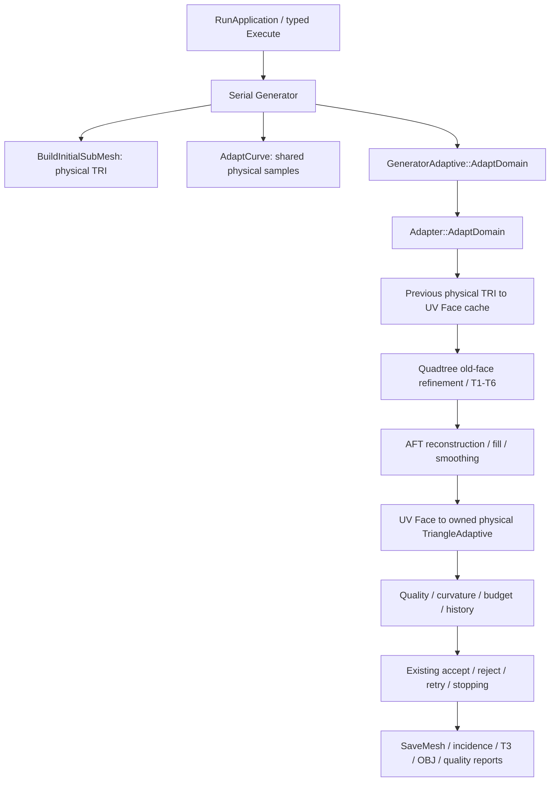

# M0 frozen serial TRI contract register

Reviewed source: `bb56d0741acdef9d775186c83bac7832a2e5c43f`; production/input trees
remain identical to the entry `f6050ec1`. Classification: engineering-only source
and coverage review. This completes the named M0-G7 static contract inventory;
it does not implement or validate QUAD behavior.

Scope: the configured serial C++17 CLI, one process/thread, MPI/OpenMP disabled,
and the existing reader/model/configuration corpus. All 164 first-party
`src/include` files (76 translation units, 88 headers) are included in the source
census. `TriangleAdaptive` is the only declared `ElementAdaptive` subclass in
that tree. External client subclasses and parallel entries retain separate gates.

## Selected serial flow and representations

`Face` is a three-endpoint UV element. A four-sided quadtree cell is a spatial
subdivision cell, not an existing physical quadrilateral element. `SubMesh`
owns physical nodes/elements; its use of a polymorphic base does not make its
consumers topology-neutral. Preserve these distinct roles.

## Complete explicit cast disposition

The retained line-based query finds 38 explicit TRI pointer/reference casts.
Compiler preprocessing uses the actual qualified GNU compilation database,
adding only `-E -fdirectives-only`; its results distinguish selected source lines
from preprocessor-excluded code, not runtime reachability.

| Disposition | Count | Sites and reason |
| --- | ---: | --- |
| Excluded from the serial profile | 17 | 12 casts at generator lines 6361-6387 in the OpenMP initial mesh builder; five at Adapter 991/1005/1087/1089/1091 in its OpenMP route |
| Compiled, no selected serial caller identified | 5 | Two-argument Generator WriteMesh at 7444 has only OpenMP callers; three casts at 8568-8570 belong to the uncalled local `escreveElementos` helper; standalone WriteOBJFile at 116 has only its declaration/definition in this tree |
| Selected serial pipeline | 16 | Generator area/quality/budget/history (535/4880/5266/5937/6235), three casts in its selected WriteMesh overload (7572/7613/7660), quality export (7779), Adapter history/output (1357/1367/1464/1466/1468), adjacency snapshot (8), incidence snapshot (90) |

The compiled legacy functions remain visible API/maintenance risks; no deletion
or unsupported-status decision follows. Every cast is retained exactly once in
the machine receipt. A compiled line is not a claim that every configuration or
scientific model exercises it.

## Semantic consumers and future QUAD gates

| Contract family | Current semantics and caller | Required future disposition |
| --- | --- | --- |
| Entry and initial physical mesh | RunApplication creates the typed Generator; InitialMesh delegates to BuildInitialSubMesh, which creates four three-node triangles around a center | M4/M7 need a deliberate initial QUAD/history route |
| Initial estimation | BuildInitialEstimateSubMesh constructs triangular cells; area/count estimation consumes their area/count, including the first triangle's area | Preserve TRI estimates; define QUAD budget/size meaning before M7 |
| Element base and concrete triangle | ElementAdaptive has virtual destruction, area/normal calculation, indexed node and angle access, but no cardinality/UV interface. TriangleAdaptive stores exactly three nodes/UV pairs and registers/unregisters all three observers | M4 requires a separate four-node lifecycle and geometry contract; do not reinterpret TRI memory |
| Node/SubMesh ownership | Node adjacency is borrowed. SubMesh owns unique elements/nodes and retires elements before replacing node owners; patch links have independent observer retirement | Reuse ownership design only after four-node adoption/rollback/destruction tests; ordinary Node copies do not clone a graph |
| Old physical mesh to UV | Adapter::AdaptDomain reads three UV pairs into cached Face; relative target length uses physical triangle area, while curvature sampling averages three vertices | M7 must define QUAD history/size/curvature conversion; UV and physical area are distinct |
| UV regional metrics | Adapter helpers compute triangle centroid/three edges, region incidence and triangle Face quality | M2/M3 need independent QUAD UV incidence/quality without changing TRI formulas |
| Quadtree old-face refinement | Quadtree::generate passes previous Face objects to cell subdivision/selection; Face center/size and triangular area/quality enter refinement | M3/M7 need a typed previous-element seam, not a fourth endpoint in Face |
| T1-T6 template emission | Cardinal neighbors classify six cases; boundary leaves are skipped. External vertex/edge sharing precedes triangular template emission and ownership transfer | M1 verifies historical polygon topology independently; M3 preserves current classification/order/identity and boundary exclusion |
| AFT reconstruction | AdvancingFront builds a triangle from a base edge plus selected vertex, publishes Face/edges, fills and smooths the triangular mesh | M5 needs an explicit boundary strategy; interior QUAD emission alone cannot fill the patch |
| Smoothing incidence | SmoothingFaceAdjacency visits getV1/2/3 and deduplicates equal pointer endpoints per face, retaining mesh order | M3/M5 need four-endpoint incidence without coordinate/ID-based deduplication or reduction-order changes |
| UV to physical output | Adapter maps each Face endpoint to an owned physical node, constructs TriangleAdaptive, assigns three UV slots and adopts the element | M4 requires typed four-node construction, registration failure rollback and consistent UV/XYZ identity |
| Physical adjacency | Adjacent's ordered neighbor tests use slots 1/2/3. Its snapshot path casts to TriangleAdaptive::GetVertexPoint; the older value path copies Node state | M4/M7 need cardinality-aware adjacency and preserved orientation; GetNoh's value copy is not a borrowed point API |
| Discrete curvature | CurvatureDiscrete orders an element star, sums area/angle and applies `3.0` factors in mean/Gaussian expressions | A QUAD formula requires scientific alignment; replacing 3 with 4 is not an engineering refactor |
| Generator quality and decisions | TriangleQualityFromNodes/Parameters and ComputeTriangleShapeMetrics3D consume three vertices; ComputeMeshQualityStats feeds existing acceptance/rejection, while patch factors/history read triangle area/quality | M4/M7 need separately defined QUAD metrics and preserved TRI thresholds/decisions; element counts alone are not equivalent accuracy |
| Selected serial exports | SaveMesh writes incidence snapshots in every output mode. The snapshot dynamically rejects non-triangles. The selected WriteMesh overload writes T3/three-index OBJ and triangle quality; WriteQualityMesh also uses three vertices/edges | M4/M6 must qualify physical/UV/boundary exports before QUAD multipatch claims; changing output mode cannot bypass the TRI assumption |
| Generic-looking reads | ElementAdaptive::GetArea/GetVectorNormal read cached values; node/element counts and PrintElments are structurally generic, but their current producers and scientific interpretation are TRI | Review cached geometry definitions and count meaning; polymorphism/container ownership alone is insufficient |

## Deliberate exclusions from triangle-cardinality changes

- Point/vector XYZ components and three-dimensional normals remain dimension 3.
- Cubic curve/patch basis degree and geometric matrix dimensions are not element node counts.
- Quadtree four children/eight perimeter slots describe subdivision and shared midside geometry.
- Adapter's three smoothing passes are an iteration budget, not the number of vertices.
- Curve publication and synchronization retain physical canonical samples and orientation; local UV subdivision cannot substitute for the M6 shared-curve contract.

## Coverage and closure limits

Existing initial mesh/estimate, ownership, UV tree/template/registration,
smoothing, candidate/snapshot, metric, accepted-root, boundary and scientific
gates cover their current TRI scopes. The 75-test/527-control baseline and the
source-bound Node/UV and current Linux instrument matrix are linked from
[M0_EVIDENCE.md](M0_EVIDENCE.md). No runtime QUAD, arbitrary foreign observer,
external subclass, recovery, MPI/OpenMP or whole-Stage-3 claim follows.

The G7 result is a reviewed register for this frozen concrete serial entry:
all named explicit casts, producer/consumer representations, indexed adjacency,
triangle-specific constants/loops and their future gates have dispositions.
Source/compile evidence is not a formal whole-program call-graph proof. Reopen
the register when a new element type, dispatch path, export or scientific rule is
introduced, and qualify that change at its own milestone.
