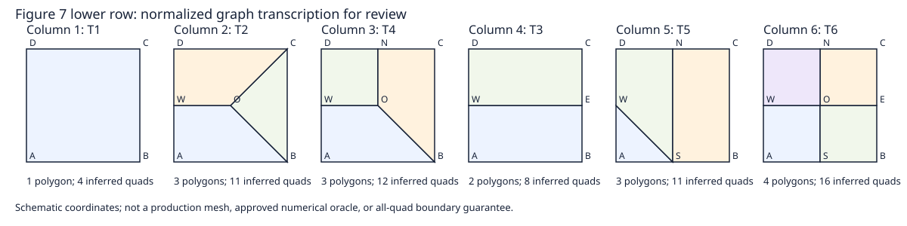

# M1 Figure 7 reconstruction for scientific review

Session 2026-11-08-06, source `069e9fb8bb8674a84baaf3cdfd04dde6799a1911`.
Classification: documentary primary-source reconstruction. **M1 remains PARTIAL:
the graph is transcribed and checked, but is not an approved executable oracle.**
No production, TRI algorithm, scientific formula, input or build change.

## Primary source and provenance

Joaquim Bento Cavalcante Neto, Marcelo Tilio Monteiro de Carvalho and Luiz
Fernando Martha, *Combinacao das Tecnicas de Quadtree e Delaunay para Geracao
Automatica de Malhas de Elementos Finitos*, SIBGRAPI VI (1993), pp. 285-291.
The [coauthor's publication list](https://web.tecgraf.puc-rio.br/~lfm/lfmartha-papers.html)
corroborates the bibliography. The actual source read here is the seven-page
local scan, SHA-256
`49d297e24c1b8695e18c6d1307aa4ccbc39f14e265d251b840a16560aca98dc5`,
5,439,448 bytes. Figure 7 is on printed p. 288, PDF page 4.

Local source: `C:\Users\tiago\Downloads\1993 SIBGRAPI Combinacao das tecnicas.pdf`.
A [Drive candidate](https://drive.google.com/file/d/1dYBOU5Q-pFRBlmFXB3iWqQaPFdd2ClzA/view)
has matching title/size metadata; remote bytes were not downloaded or hash-compared.
Do not infer byte identity from its name. The scanned PDF and page images are
not redistributed in the repository. Local render/provenance records remain at
`build/quad-m1/session-20261108-06/`.

`pdfinfo` identifies a seven-page scanned document. `pdftotext -layout` returns
only page separators, so text extraction supplies no topology evidence. Visual
inspection uses 1,500-pixel full-page renders, a 400-dpi Figure 7 crop and an
800-dpi fifth/sixth-pattern detail. Pages 285, 287-290 were read for authorship,
balancing, interior patterns and boundary limitations. The first fifth-pattern
crop selected text rather than the diagram; it is retained separately and is
not the basis of the transcription.

## Figure order and source classifier

The paper does not print T1-T6 labels over its columns. Those labels come from
the current [neighbor classifier](../../../src/crab_mesh/aft/quadtree_cell.cpp#L1844)
and [side enumeration](../../../include/data/definitions.h#L877). Under the
balanced interior-cell precondition each side has one or two neighbors; a split
side has two finer neighbors. Boundary cells are excluded by the current caller.
The bottom/right/top/left enum order is preserved. No classification code changes.

**Printed columns map to T1, T2, T4, T3, T5, T6.** In particular, the adjacent
two-split-side case precedes the opposite-side case. Column position must not
be used as the existing source's type number. All 16 four-side split signatures
fall in these six rotation classes (sizes 1, 4, 4, 2, 4, 1 in printed order).
The current final `else` is not a validator for malformed neighbor counts;
this review does not change or qualify inputs outside the stated precondition.

## Ordered polygon transcription

Use a normalized schematic square: A=(0,0), B=(1,0), C=(1,1), D=(0,1);
S/E/N/W are its bottom/right/top/left midpoints. O=(1/2,1/2) denotes a visible
central junction. Coordinates and CCW orientation are our explicit transcription
convention: **the paper supplies no numerical coordinate/ordering table**.
These values are not a claim about measured scan pixels, historical IDs,
publication order, current code output or an approved physical embedding.

| Figure column | Current class | Split sides as drawn | CCW polygon cycles | Polygon degrees | Inferred QUAD count after the paper's later subdivision |
| --- | --- | --- | --- | --- | --- |
| 1 | T1 | none | A B C D | 4 | 4 |
| 2 | T2 | W | A B O W; B C O; W O C D | 4,3,4 | 11 |
| 3 | T4 | N,W | A B O W; W O N D; O B C N | 4,4,4 | 12 |
| 4 | T3 | E,W | A B E W; W E C D | 4,4 | 8 |
| 5 | T5 | S,N,W | A S W; W S N D; S B C N | 3,4,4 | 11 |
| 6 | T6 | S,E,N,W | A S O W; S B E O; O E C N; W O N D | 4,4,4,4 | 16 |

Column 5 has **no central junction O**: its vertical S-N edge is uninterrupted,
and W joins S diagonally. Inserting O as a polygon vertex changes the subsequent
midpoint subdivision even if it leaves the drawn straight line unchanged.
Columns 2 and 5 include a triangular intermediate polygon; these are polygon
templates, not final quadrilateral element lists.

The [machine-readable transcription](evidence/M1_FIGURE7_TRANSCRIPTION_20261108.json)
retains source identity, conventions and open decisions. The figure is a new
schematic of that graph, not a reproduction of the scanned page.

## What the surrounding text establishes

On p. 288 the paper separates polygon construction from later subdivision:
introduce an edge midpoint for each polygon side, insert a polygon centroid,
and connect that centroid to the side midpoints. Thus a valid k-sided polygon
would yield k quadrilaterals. The counts above are a graph-derived consequence,
not counts measured from an implemented generator or explicitly tabulated by
the paper. Shared midpoint identity, degeneracy and physical quality remain
future implementation/qualification obligations.

The paragraph specifies a centroid but gives no formula for its computation.
For non-triangular polygons, an area centroid and a mean of vertices need not
coincide. A numerical oracle must state the chosen interpretation and its
independent expected values before implementation; it cannot silently inherit
the triangle centroid or current quality-optimized TRI center.

Pages 289-290 describe boundary triangulation and optional triangle pairing.
When no acceptable pair is selected, a triangle may be retained. Consequently,
the paper does not establish a general all-quad boundary guarantee. Its angle
acceptance rule and smoothing description are historical context, not policies
adopted into the current program. M5 still needs an explicit target decision.

## Documentary consistency checks and their limits

The [audit receipt](evidence/M1_TRANSCRIPTION_REVIEW_20261108.json) records an
offline rational-coordinate check: all six graphs under eight D4 operations
(48 observations) retain positive area/strict convexity, total area one,
opposite directed internal incidences, boundary-only unpaired edges and disk
Euler characteristic. Reflection reverses polygon winding explicitly. The
transformed boundary coordinates produce all 16 split signatures with the
class orbit sizes above. Symmetry here does not authorize a runtime emission
order or assert that the paper specifies every reflected implementation.

Six deliberately altered records are detected: missing polygon, reversed
polygon, repeated vertex, duplicate polygon, swapped T3/T4 label and invented
T5 center. These are checks of the documentary transcription, not six new
production tests or a completed QUAD scientific test suite. Rational schematic
consistency cannot independently establish that a human read the scan correctly.

## Admission and explicit closure audit

| Area | Current disposition |
| --- | --- |
| Code | No production/build/test change; local reader/checker only; typed QUAD fixtures/emission remain absent |
| Tests | 48 schematic observations and six detected altered records; full exact-checkpoint regression required before publication, separately from these checks |
| Contracts | Split-side class mapping and polygon incidence/ordering conventions explicit; midpoint identity, numeric centroid and runtime order not adopted |
| Documentation | Source hash/pages, ordered table, SVG, checks, limitations and pending decisions recorded; remote Drive content identity unverified |
| Scientific scope | Primary-source proposal for review only; no geometry/curvature/boundary formulation or novelty claim |
| Known gaps | Independent human confirmation, approved numeric embedding/centroid, executable positive/negative fixtures and future M2-M7 contracts remain open |

**Next action:** review the six graph cycles and column/class mapping against
the identified scan with the advisers; record alignment on the normalized
embedding and centroid definition. Then implement isolated M1 fixtures in a
reviewable branch targeting `quad-templates`, with analytic expectations,
orientation/degeneracy negatives and visualization. The current agreement and
[state](STATE.md) require adviser alignment for scientific choices; a generic
continuation instruction does not itself resolve those choices. M1 is not closed,
M2 is not admitted, and modernization Stage 3 remains separate.

## Status update — 2026-11-10 (supersedes only the old executable-test status)

The table above is a historical snapshot from 2026-11-08 and correctly reported **no committed executable M1 oracle at that time**. PR [#195](https://github.com/tiagosombrra/apmesh-modernization/pull/195) now adds an [independently implemented exact-rational test](../../../tests/quad/test_m1_figure7_oracle.py) and [audit evidence](evidence/M1_EXECUTABLE_ORACLE_20261110.json). Linux GCC and Windows MSVC **5/5 native CTest** passed on exact candidate SHA `2bb2ecb1a7daacb153116c6c8486d49bdd6d1c50`, with unchanged TRI science reference. The test checks the *proposed transcription* under D4 and two different **test-only** interior-point witnesses; it does not establish independent visual source corroboration or a historically approved centroid equation. M1 **continues PARTIAL**, and no positive production QUAD output was enabled. The scientific decision queue is [M1 numerical policy](M1_NUMERIC_DECISION_GATE_20261110.md).
